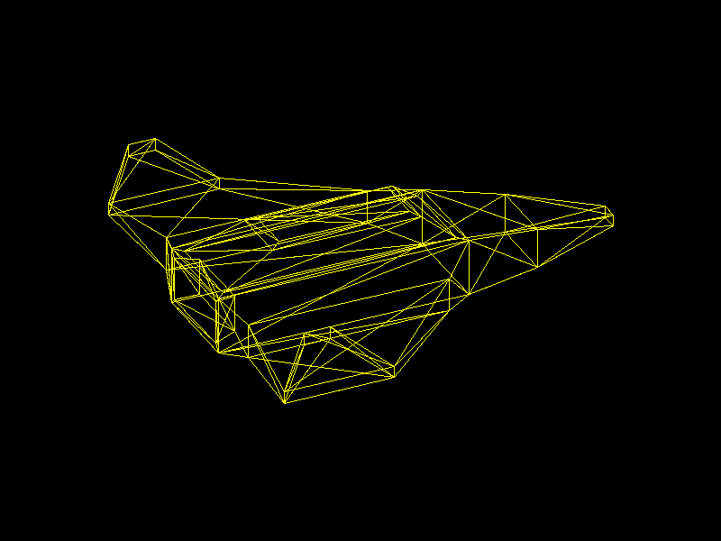

# Lab 4 – Software Renderer: modelo OBJ

Primer ejercicio del Proyecto 1 de Gráficas por Computadora. Se carga la nave espacial modelada en Blender en el Lab 3 (`models/nave.obj`) y se dibuja en pantalla con una función propia para pintar triángulos sobre un framebuffer (SDL2).



## Cómo funciona

1. `objloader.cpp` lee el `.obj`: guarda las posiciones (`v`) y, por cada cara (`f`), los índices de sus vértices.
2. `render()` en `main.cpp` recorre manualmente las caras. Con los índices de cada cara obtiene sus vértices. Las caras del modelo son cuadriláteros, así que cada una se divide en triángulos en abanico (`0,1,2`, `0,2,3`).
3. Cada vértice se rota para ver la nave en vista 3/4 y se escala y traslada para que el modelo quede centrado y ocupe ~70% de la pantalla.
4. `triangle()` une los tres vértices con `line()` (Bresenham), y `line()` pinta cada pixel con `point()` en el framebuffer.

## Estructura

```
src/
  main.cpp          // init, loop principal y render()
  color.h           // struct Color
  framebuffer.*     // clear(), point(), renderBuffer(), saveBuffer()
  line.*            // línea con Bresenham
  triangle.*        // triángulo = 3 líneas
  objloader.*       // lector de archivos .obj
models/
  nave.obj, nave.mtl, nave.blend
```

## Compilar y ejecutar

Requisitos: compilador de C++17, CMake, SDL2 y glm (en Windows: MSYS2 UCRT64 con `mingw-w64-ucrt-x86_64-{gcc,cmake,ninja,SDL2,glm}`).

```bash
cmake -S . -B build -G Ninja
cmake --build build
./build/renderer models/nave.obj
```

- Presiona `S` para guardar una captura en `screenshot.bmp`.
- `--screenshot archivo.bmp` dibuja un frame, lo guarda y cierra el programa.
